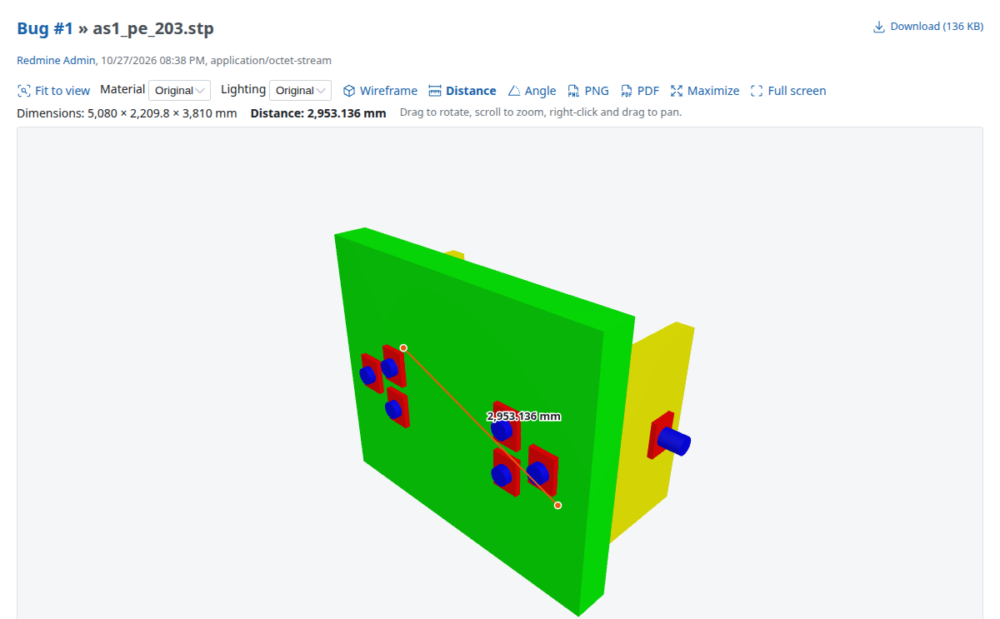
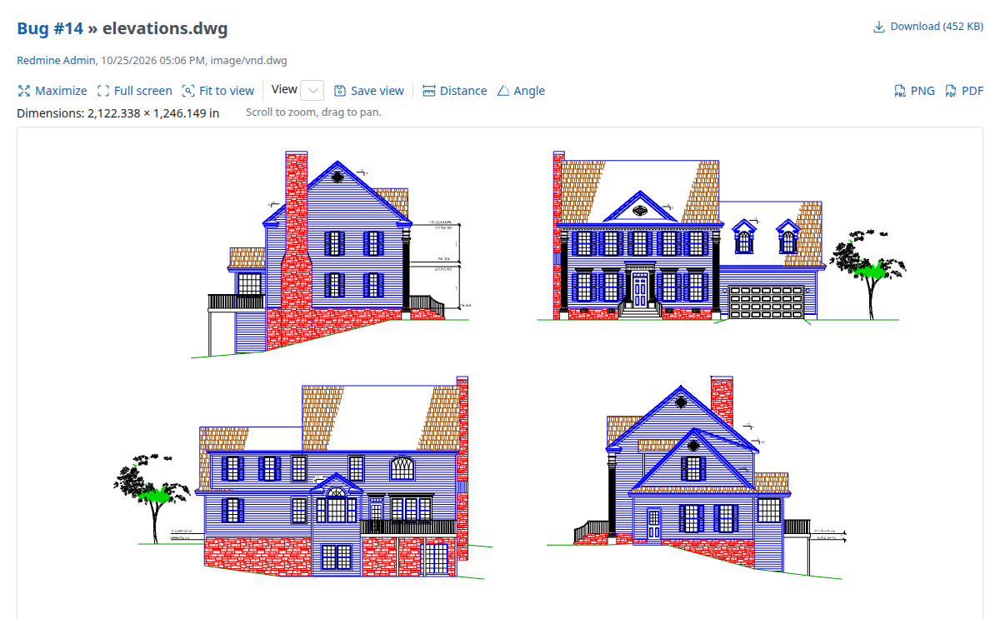

# Redmine CAD Preview Plugin

## cosmoBots fork: studio lighting and material controls

Development revision `1.0.1-cosmobots.1` adds procedural studio environment
lighting (PMREM/RoomEnvironment, no external HDR downloads), essential for
fully metallic glTF materials. Each 3D viewer offers Original/Matte material
and Original/Studio lighting selectors. Matte clones preserve model colors,
textures and transparency; switching back restores the original materials.
Uploaded model files are never rewritten.

Integrations can register initial defaults with
`RedmineCadPreview::ViewerOptions.register(:integration) { |attachment| ... }`.
Supported keys are `material_mode` (`original`/`matte`) and `lighting`
(`studio`/`original`); values are allow-listed. The optional
`cosmosys_cad_preview` plugin supplies cosmoSys defaults via this API, without
duplicating viewer code. `cd frontend && npm ci && npm test && npm run build`
rebuilds the bundled asset. No new npm dependencies or database migrations.

Upstream: https://github.com/flowalchs/redmine_cad_preview. The original MIT
license and author attribution remain intact. Saved views, wiki macros and
static report figures are not implemented by this first change.

[](https://github.com/flowalchs/redmine_cad_preview/actions/workflows/build.yml)
[](https://github.com/flowalchs/redmine_cad_preview/releases/latest)
[](https://www.redmine.org/plugins/redmine_cad_preview)
[](https://www.redmine.org)
[](https://codecov.io/gh/flowalchs/redmine_cad_preview)

This plugin shows CAD attachments directly in Redmine: 3D models can be rotated, zoomed and panned, 2D drawings can be zoomed and panned. Instead of "No preview available", the attachment page shows an interactive viewer for issues, documents, files and wiki pages.

## 🧠 How it works

- **In the browser**: The files are displayed by a viewer that runs in the browser (three.js, OpenCASCADE as WebAssembly, dxf-viewer). The libraries are included in the plugin, so no internet access is needed.
- **Files stay in Redmine**: The browser loads the file from Redmine with the same permissions as a download. No file is sent to a third party.
- **DWG on the server**: DWG files are converted to DXF on the server with [LibreDWG](https://www.gnu.org/software/libredwg/). The conversion runs in the background right after the upload, so the preview is ready when it is opened.
- **Thumbnails**: The thumbnails in the attachment lists are made from the image that CAD programs save in the file (Inventor, Solid Edge, SolidWorks, FreeCAD, 3MF, DXF, DWG). For files without image, the browser sends a snapshot of the viewer when the preview is opened for the first time by a user who can edit the attachment.

## 🌟 Features

- **3D preview** – STEP (.step, .stp), IGES (.iges, .igs), BREP (.brep, .brp), FreeCAD (.FCStd), STL, OBJ, 3MF, glTF (.gltf, .glb), PLY, Collada (.dae), FBX, VRML (.wrl, .vrml), AMF, 3DS
- **2D preview** – DXF, and DWG converted to DXF
- **Autodesk Inventor** (.ipt, .iam, .ipn, .idw, .ide), **Solid Edge** (.par, .asm, .psm, .pwd, .dft) and **SolidWorks** (.sldprt, .sldasm, .slddrw) – Shows the preview image that these programs save in the file
- **Thumbnails** – CAD attachments get thumbnails in the attachment lists, like images (with ImageMagick, if thumbnails are enabled in the Redmine settings)
- **File icons** – 3D models and 2D drawings get their own icons in the attachment lists, from Redmine 7.0 (which shows file type icons there). Redmine 7.0 only passes the content type, so only files with a CAD content type get the icons there, e.g. DWG, DXF, STL and IGES. Redmine trunk also passes the filename, so all CAD files get the icons. Icons of the theme are used first.
- **Viewer controls** – Rotate, zoom, pan, fit to view, wireframe
- **Measuring** – Overall dimensions of the model or drawing, distance between two points and angle between three points (without snapping). The unit is taken from the file where it is known (STEP, IGES, BREP: mm, glTF: m, DXF: `$INSUNITS`).
- **Download of the current view** – As PNG image or PDF (A4) with the measurement, the file name and the dimensions. Created in the browser, without an additional library.
- **Maximize and full screen** – Maximize the viewer to the browser window (remembered in the browser) or switch to full screen
- **Background conversion of DWG files** – Started after the upload. A failed conversion is attempted at most twice, so opening the preview does not start a new conversion every time.
- **Settings** – Previewed formats, maximum file size, DWG converter command and timeout
- **No migration and no additional gems**

## 📸 Screenshots

| 3D model (STEP) with a distance measurement | 2D drawing (DWG) |
| --- | --- |
| [](docs/screenshot-3d.png) | [](docs/screenshot-2d.png) |

## ⚙️ Plugin Configuration

Configure the plugin under **Administration → Plugins → Redmine CAD Preview → Configure**:

| Setting                       | Description                                                                 |
| ----------------------------- | --------------------------------------------------------------------------- |
| Previewed formats             | Formats shown in the viewer (default: all)                                  |
| Maximum file size             | Larger files are not previewed (default: 50 MB). The file is loaded and converted to triangles in the browser, which needs a multiple of the file size in memory. On the server, the file is sent like a download, so the limit only matters for the DWG conversion, which runs as a separate process. |
| dwg2dxf command (LibreDWG)    | Command of the DWG converter, e.g. `/usr/local/bin/dwg2dxf` (default: `dwg2dxf`) |
| Conversion timeout            | Maximum time of a DWG conversion in seconds (default: 30)                   |

The settings page shows whether the DWG converter is available. Without it, DWG files are not previewed, and all other formats still work.

## 📐 DWG conversion with LibreDWG

LibreDWG is installed separately on the server. It is not included in the plugin. On Ubuntu 24.04, there is no package for it, so it is built from source:

```bash
sudo apt-get install build-essential
curl -LO https://ftp.gnu.org/gnu/libredwg/libredwg-0.14.tar.xz
tar xf libredwg-0.14.tar.xz
cd libredwg-0.14
./configure --prefix=/usr/local --disable-bindings --disable-python --disable-docs
make -j"$(nproc)"
sudo make install
sudo ldconfig
dwg2dxf --version
```

The converted files and the images for the thumbnails are stored in `files/derived_cache/cad_previews` and deleted together with the attachment.

The conversion runs as an Active Job. With the default queue adapter of Redmine, it runs in the background of the Redmine process.

## ⚠️ Limitations

- **DWG**: LibreDWG reads older DWG versions well. Newer DWG versions (2018 and later) are only partly supported, e.g. some texts may be missing.
- **3D solids in DXF and DWG**: 3D solids (ACIS data, e.g. `3DSOLID`) cannot be displayed. The preview shows a notice, and for drawings made of 3D solids the image saved in the file.
- **glTF**: `.gltf` files that reference external `.bin` or texture files are not supported. Use `.glb` instead.
- **FreeCAD**: The visible objects of the document are shown, with their color. Documents with only 2D objects (sketches, wires) cannot be displayed.
- **Textures and animations**: Textures in separate files (e.g. of OBJ, FBX, Collada and 3DS files) are not loaded, only the colors of the materials are shown. Animated models are shown in their rest pose.
- **Large models**: STEP and IGES files are converted to triangles in the browser. Very large models can take a while and need a lot of memory.
- **Measuring**: Points are picked on the surface of the model or anywhere in the drawing, without snapping to edges or end points. STL, OBJ and 3MF files have no unit, so measurements are shown in "units".
- **Autodesk Inventor, Solid Edge and SolidWorks**: Only the preview image saved in the file is shown, the model itself cannot be read without these programs. Export the model as STEP to view it in 3D. The image is the view of the last save.
- **.asm files** are only treated as Solid Edge assemblies if they are OLE compound files, so that assembler source files are not affected.

## 📋 Requirements

- **Redmine**: 6.0 or higher
- **Ruby**: as required by your Redmine version (tested with 3.2 – 4.0)
- **Database**: MySQL or PostgreSQL
- **Browser**: with WebGL and WebAssembly support (all current browsers)
- **Optional**: LibreDWG for the preview of DWG files

## 🚀 Installation

```bash
cd $REDMINE_ROOT/plugins
git clone https://github.com/flowalchs/redmine_cad_preview.git
```
Restart your Redmine server to load the plugin. No database migration and no `bundle install` are needed, as the plugin has no Gemfile.

## 🧪 Tests

```bash
cd $REDMINE_ROOT
bundle exec rake redmine:plugins:test NAME=redmine_cad_preview RAILS_ENV=test
```

With `COVERAGE=1`, a coverage report is created in `coverage/` (with `simplecov` of Redmine). The Cobertura report for Codecov is created only if `simplecov-cobertura` is installed, e.g. with `gem 'simplecov-cobertura'` in Redmine's `Gemfile.local`.

The tests use a stand-in for `dwg2dxf` (`test/support/fake_dwg2dxf`), so LibreDWG is not needed to run them. The test files with images are built with `test/support/build_fixtures.rb`.

## 🛠️ Development

The viewer is built from the sources in `frontend/` into `assets/`. The built files are included in the repository and in the release, so users do not need Node.js.

```bash
cd frontend
npm ci
npm run build
```

### Included JavaScript libraries

The versions are pinned in `frontend/package.json` (exact versions) and `frontend/package-lock.json`:

| Package | Used for | Included in the build |
| --- | --- | --- |
| `three` | 3D viewer, loaders for STL, OBJ, 3MF and glTF | `assets/javascripts/cad_preview.js` |
| `occt-import-js` | Reading STEP, IGES and BREP (WebAssembly) | `assets/javascripts/occt-import-js.{js,wasm}` |
| `dxf-viewer` | DXF viewer (with `opentype.js`, `earcut`, `loglevel`) | `assets/javascripts/cad_preview.js` |
| `@fontsource/noto-sans` | Font for texts in DXF drawings | `assets/fonts/` |
| `@tabler/icons` | Toolbar and file icons | `assets/images/icons.svg` |
| `esbuild` | Bundler (only for the build) | – |

Dependabot checks the libraries once a month and opens a pull request with the updates. The workflow `frontend.yml` rebuilds the viewer in this pull request and updates the versions in [THIRD_PARTY_NOTICES.md](THIRD_PARTY_NOTICES.md). Before merging:

1. Check the license texts in `licenses/` if a license changed.
2. Check the preview of all formats, as `dxf-viewer` is used with a patch of its parser (counting 3D solids, see `frontend/src/cad_preview.js`).

To update a library by hand, change the version in `package.json`, then run `npm install`, `npm run build` and `node notices.mjs --write`. Other pull requests that change `frontend/` must contain the rebuilt files, which `frontend.yml` checks.

## ❌ Uninstall

Remove the directory `plugins/redmine_cad_preview` and restart your Redmine server. The converted DWG files in `files/derived_cache/cad_previews` can be deleted.

## 📜 License

MIT License. The included third-party libraries have their own licenses, see [THIRD_PARTY_NOTICES.md](THIRD_PARTY_NOTICES.md).
